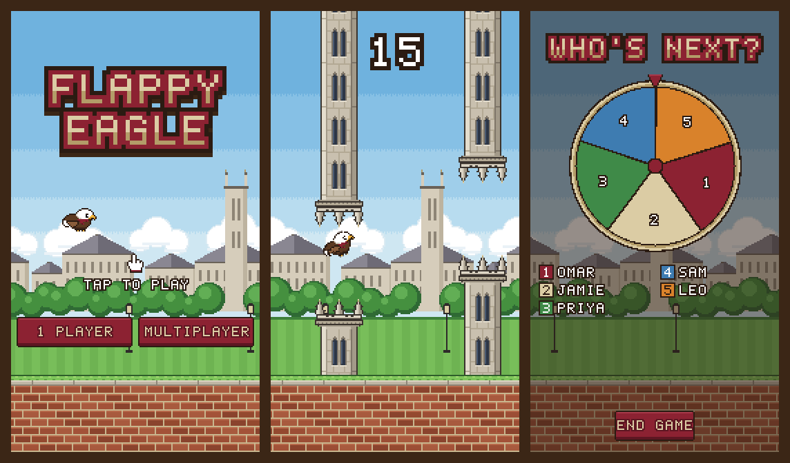
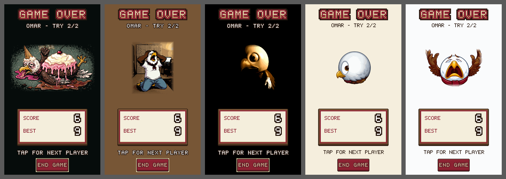

# Flappy Eagle

A Boston College themed one-tap flyer for the browser. Guide the eagle through the gaps between Gasson Hall spires over the Quad, alone or in a pass-the-phone match for up to 10 players.



It is plain HTML, CSS and JavaScript: no build step, no dependencies, no frameworks. All of the art is drawn in code as pixel art, apart from the loss-screen images, which are bitmap sprites.

> Unofficial fan project. Not affiliated with, sponsored by or endorsed by Boston College. See [Credits and disclaimer](#credits-and-disclaimer).

---

## Contents

- [Play it](#play-it)
- [How to play](#how-to-play)
- [Multiplayer](#multiplayer)
- [Loss screens](#loss-screens)
- [On phones and tablets](#on-phones-and-tablets)
- [Accessibility](#accessibility)
- [Project structure](#project-structure)
- [How it works](#how-it-works)
- [Customizing](#customizing)
- [Credits and disclaimer](#credits-and-disclaimer)

---

## Play it

Flappy Eagle is a static site: no build step, no server code. It is deployed on [Netlify](https://www.netlify.com/).

**Deploy from GitHub (recommended)**

1. In Netlify, choose **Add new site → Import an existing project → GitHub**, and pick this repository.
2. Leave the build command empty. `netlify.toml` already sets the publish directory to the repository root.
3. Deploy. Every push to `main` redeploys automatically.

Deploying from the repository publishes only the files committed here, so local source renders (ignored by `.gitignore`) never reach the site.

**Drag and drop.** You can also drag a folder onto Netlify's **Sites** page. Use a fresh clone of this repository rather than a working folder, so only the game's files are uploaded.

The game needs to be served over HTTP or HTTPS; opening `index.html` straight from disk blocks the loss-screen images. The menu font loads from Google Fonts. Without it, menus fall back to the system monospace font and everything else still works.

---

## How to play

| Action | Touch | Mouse | Keyboard |
|---|---|---|---|
| Start 1 player (title screen) | Tap anywhere | Click | Space, Up or Enter |
| Flap | Tap | Click | Space, Up or Enter |
| Retry after a crash | Tap | Click | Space, Up or Enter |
| Menu buttons | Tap | Click | Tab to focus, then Enter or Space |

- Each tap sets the eagle's upward speed; gravity pulls it down between taps.
- You score a point for each pair of towers you pass.
- Touching a tower or the ground ends the flight. The spire tips (pinnacles) are left out of the hitbox as a little grace.
- After a crash, taps are ignored for about half a second so a panic tap can't skip the results.
- Your best 1-player score is saved in the browser (`localStorage`, key `flappyEagleBest`). Multiplayer scores never touch it.

The 1-player game-over screen offers **1 Player** (fly again), **Multiplayer** (go to player setup) and **Home** (back to the title screen). Tapping anywhere else also retries.

---

## Multiplayer

1. **Players.** The setup screen starts with two name boxes. **Add player** adds more, up to 10. Boxes fill left to right, each with its order number, and the screen scrolls if they overflow. Names are optional (blank shows as `PLAYER n`), up to 10 characters, using letters, digits and `! ? . ' -`.
2. **Player order.**
   - **Standard:** players go in list order.
   - **Random:** before each turn a color-coded wheel spins (fast, then slowing down) and picks who is next. The wheel uses `crypto.getRandomValues`, so every remaining player has an equal chance. It is skipped for the last player, since there is no one left to pick from.
3. **Two tries each.** The ready screen shows whose turn it is and that each player gets 2 tries, with the best one counting.
4. **Final scores.** A leaderboard ranks everyone by their best try. Ties share a rank, and the winner's row is highlighted in gold.

**End game.** The game-over and wheel screens have an **End game** button that jumps straight to the leaderboard. Anyone who hasn't flown yet is listed at the bottom with a score of `-`.

From the leaderboard, **Play again** keeps the same players and returns to the order choice; **Menu** goes back to the title screen.

---

## Loss screens

When a player crashes on their **final try** in multiplayer, the game-over screen shows a randomly chosen gag image of the eagle, never the same one twice in a row. The image's own background color fills the whole screen, and the screen's text and buttons adjust to stay readable on it.



| Image | Fill | Text |
|---|---|---|
| Melted: the eagle under a collapsed sundae | Near black | White, outlined |
| Scream: on its knees, wings on its head | Carpet brown | White, outlined |
| Dark: one huge eye and a white glove | Black | White, outlined |
| Side-eye: the eagle as a round emoji | Beige | Ink |
| Crying: wailing emoji with wings thrown up | White | Ink |

On the three dark fills the **End game** button gets a gold ring, because its ink outline would otherwise vanish. Every text and edge pair meets WCAG AA contrast; the lowest is 4.2:1 for the gold ring on the scream's brown fill. Screen readers hear a short description of each image.

The art is drawn at 2 art pixels per game pixel on its own canvas, which keeps the sprites' full resolution. Its outer edge is dithered into the fill color, so busy scenes blend into the screen instead of looking framed.

---

## On phones and tablets

- **Full screen button.** On touch devices a small button sits in the bottom-left corner of the menus, the ready screen, game over and the wheel. It is hidden during a flight, and on the setup and leaderboard screens, whose own buttons run along the bottom edge. Its pixel icon shows what pressing it will do:
  - **Corners pointing out:** go full screen and hide the browser bar. On Android it also locks the game to portrait.
  - **Corners pointing in:** leave full screen. The game still fills the screen; the browser bar just returns at the top.
- **iPhone.** Safari on iPhone does not let web pages go full screen. There, the button shows a short tip instead: tap **Share**, then **Add to Home Screen**. The game then opens from its own home-screen icon with no browser bar, and the button is not needed. A web app manifest and icons set this up, and the same install works on Android.
- **Touch handling.** Input is on `pointerdown`, so taps register immediately. Double-tap zoom, pull-to-refresh, text selection and long-press menus are disabled on the game. The scrolling menu screens still scroll.
- **Name boxes** use at least a 16 px font, so iPhone Safari does not zoom in when one is tapped.
- **Scaling.** The game renders at 180×320 game pixels. On screens taller than 9:16, which covers most modern phones, it fills the full width and the scene continues past the game area: sky above, brick walk below, or a loss screen's color on loss screens. Wider screens, like desktops and tablets, scale by a whole number when there's room, so pixels stay perfectly even, and show a frame around the game.
- **Frame rate.** Physics runs at a fixed 60 steps per second, so the game feels the same on 60 Hz and 120 Hz screens.

---

## Accessibility

- All menus are real HTML buttons and inputs laid over the canvas, so they work with keyboards, switch access and screen readers. Focus is moved to each menu's heading when it opens, and focused buttons show a white outline.
- A hidden live region announces game states: get ready, scores after each flight, whose turn it is, the wheel's pick and the final results.
- Colors were checked against WCAG 2.1: gold on maroon buttons is 5.5:1, and maroon text on the cream panels passes AA.
- Player badges pick ink or white text, whichever contrasts more with the player's color.
- Nothing flashes more than once. The single white flash on a crash fades over about a fifth of a second.

---

## Project structure

```
netlify.toml            Netlify deploy settings (publish the repository root, no build)
index.html              Page, CSS and the HTML menus laid over the canvas
game.js                 Game loop, physics, menus, multiplayer, wheel, loss screens, full screen
sprites.js              All procedural pixel art, the bitmap font and UI pieces
sprites.html            Sprite review sheet (open via the local server)
manifest.webmanifest    Home-screen install settings
icons/                  App icons (180, 192 and 512 px)
Loss screen renders/    The five loss-screen sprites the game loads
docs/                   Screenshots for this README
tools/spriteify.py      Turns a painted render into a palette-reduced pixel sprite
```

---

## How it works

**Rendering.** One 180×320 canvas, scaled with nearest-neighbor filtering (`image-rendering: pixelated`). A CSS variable `--u` holds the size of one game pixel in CSS pixels, so the HTML menus line up with the canvas art at any scale.

**Art.** `sprites.js` builds every sprite at load time:
- the eagle's body and three wing frames from character grids with palettes;
- the Gasson-style tower cap and a repeating body tile; hanging towers flip only the cap, so the windows stay upright;
- the Quad background (sky bands, clouds, Gothic halls, a tower, trees, lawn and lamps) and the brick walk;
- an original 5×7 bitmap font with outline and shadow layers.

**Game loop.** A fixed-timestep accumulator runs `update()` 60 times per second and `draw()` once per display frame. The eagle is a circle (radius 7) tested against each tower's rectangles. Towers spawn 104 px apart, and each gap's height moves by at most 90 px from the previous one, so every gap can be reached.

**Feel.** Every tuning number lives in one object at the top of `game.js`:

| Setting | Value | Meaning |
|---|---|---|
| `gravity` | 0.24 | Downward acceleration per step |
| `flap` | -4.4 | Vertical speed set by each tap |
| `maxFall` | 7 | Terminal fall speed |
| `speed` | 1.25 | Scroll speed of towers and ground |
| `gap` | 74 | Height of the opening between towers |
| `spacing` | 104 | Horizontal distance between tower pairs |
| `gapTopMin` / `gapTopMax` | 40 / 170 | Range for the top of each opening |
| `maxShift` | 90 | Largest height change between neighboring gaps |

**Wheel.** The random-order wheel is drawn pixel by pixel. It picks the winning slot uniformly, lands somewhere in the middle 70% of that slot so it never stops on a divider, and spins 4 to 6 full turns over 4 to 5 seconds with a cubic ease-out.

**Loss screens.** Each sprite's fill color is the most common pixel on its border, unless one is set by hand (the scream uses its carpet brown). The outer 12 art pixels are blended into the fill with a 4×4 ordered dither.

---

## Customizing

- **Game feel:** edit `TUNING` at the top of `game.js`.
- **Number of tries or players:** `TRIES` and `MAX_PLAYERS` in `game.js`.
- **Player colors:** `PLAYER_COLORS` in `game.js`.
- **Palette:** the `C` object at the top of `sprites.js`.
- **Add a loss screen:**
  1. Make a pixel sprite of the eagle about 32,000 pixels in area, with even width and height, and at most 328×284 so it fits the space between the title and the score panel. `tools/spriteify.py` can turn a painted render into one:
     ```bash
     python3 tools/spriteify.py render.png "Loss screen renders/name-sprite-200x160.png" 200 160 40 FASTOCTREE 8C2232,5E1622
     ```
     The arguments are: source, output, width, height, palette size, quantizer, and optional colors to pin into the palette (the BC maroons keep the scarf from turning brown). Set `INK=20` (or lower) in front of the command for dark scenes, so shadows aren't traced as outlines.
  2. Add an entry to `LOSSES` in `game.js`: the file name, a short description for screen readers, and optionally a fill color.

---

## Credits and disclaimer

- **Unofficial fan project.** Flappy Eagle is not affiliated with, sponsored by or endorsed by Boston College. Boston College's name, colors, mascot and campus landmarks are used here for a non-commercial fan tribute; they belong to the Trustees of Boston College.
- **Genre.** A tribute to the one-tap flyer genre made popular by *Flappy Bird*. All code, constants and art in this repository are original; nothing was copied or extracted from that game.
- **Art.** The game's sprites, background, towers, font and UI are original pixel art drawn in code. The loss-screen images are parodies of well-known internet memes: they were generated as illustrations of the game's eagle with an AI image model (via Higgsfield), then converted to pixel sprites with `tools/spriteify.py`.
- **Font.** Menu text uses [Silkscreen](https://fonts.google.com/specimen/Silkscreen) by Jason Kottke, under the SIL Open Font License, loaded from Google Fonts.
- **License.** No license has been chosen for this repository yet.
